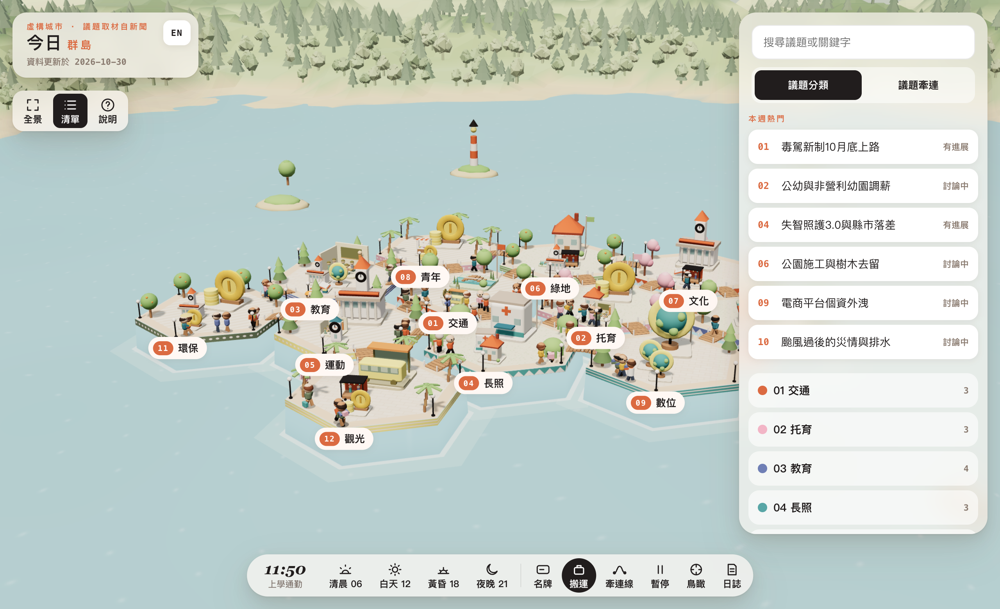

# 今日群島

一座由 12 座六角形小島拼成的 3D 互動城市，呈現「此刻大家在討論的事」。每座島是一類議題，島上的小建物是一則取材自新聞的議題。點開議題，會看到發生什麼、為什麼跟你有關、各方怎麼看，以及新聞來源。小人在島與島之間來回走，呈現議題之間怎麼互相牽動。整座城市跟著一天的時段走，從清晨到深夜都會變化。

城市和角色都是**虛構的**；議題取材自近期台灣新聞，每則都附來源。各方看法只寫角色、不寫人名，不代表任何政黨、候選人或機構的立場。

專案原名「示範市政策島」，內容是虛構的政見；2026-10-30 改為現名，並改成依新聞更新的議題地圖。

**線上版**：https://island-game.kh-lab.workers.dev（加上 `#en` 切換成英文）

**製作過程**：[一份流傳的 prompt 怎麼變成這座 3D 城市](https://kerry-notes.kh-lab.workers.dev/posts/island-policy-city/)



## 特色

- 單一 HTML 檔，用原生 ES Modules 載入 Three.js 0.160.0，沒有任何建置工具或框架。
- 不載入圖片、模型或字型檔。所有幾何都由程式產生，所有貼圖都用 canvas 即時繪製。
- 議題放在 `data/issues.json`，用 `scripts/validate.mjs` 驗證格式、中立用字與來源日期。換一份資料，就是另一座城市。
- 熱門議題會插旗，清單最上方列出「本週熱門」。
- 所有隨機都用固定種子，每次載入的場景完全一樣。
- 有日夜循環、議題牽連線、城市日誌、中英雙語、手機版 bottom sheet，並支援 prefers-reduced-motion。

| 夜晚與牽連線 | 議題卡片 | 手機版 |
|---|---|---|
|  |  |  |

## 文件

- [遊戲介紹](docs/introduction.md)：這座城市裡有什麼，各個元素代表什麼意思。
- [操作手冊](docs/manual.md)：桌面版與手機版的操作方式，以及每顆按鈕的用途。
- [開發指南](docs/development.md)：程式結構、資料格式、怎麼換內容、怎麼建置與部署。
- [更新守則](docs/update-guide.md)：議題怎麼依新聞更新，哪些事不能做。
- [進度紀錄](NOTES.md)：開發過程中做過的決定，以及跟原始規格不同的地方。

## 快速開始

```sh
node scripts/validate.mjs      # 驗證 data/issues.json
sh build.sh                    # 把 parts/ 與議題合併成 index.html、preview.html、dist/index.html
python3 -m http.server 8765    # 開本機 server
# 用瀏覽器打開 http://localhost:8765/preview.html
```

部署到 Cloudflare：

```sh
sh build.sh && npx -y wrangler@4.155.0 deploy
```

詳細步驟見[開發指南](docs/development.md)。

## 來源與致謝

- **靈感**：2026 年 10 月台北市長選戰中，沈伯洋競選團隊推出的「HEART 政策島」，用六角形小島拼成城市來呈現政見，之後引發一波模仿與二創。背景可參考[維基百科「政策島」條目](https://zh.wikipedia.org/wiki/%E6%94%BF%E7%AD%96%E5%B3%B6)與 [AI 新視界的技術拆解](https://aiview.tw/articles/teardown-heart-island-threejs-ai-built-2026-10)。
- **規格**：來自網路上流傳的「{示範市}政策島」prompt 模板，城市名留空讓人自填。確切出處不明。
- **程式**：依那份規格從零寫成，沒有複製 HEART 政策島或其他政策島的原始碼與資料。本專案與任何政黨、候選人或競選團隊都沒有關係。
- **第三方套件**：[Three.js](https://threejs.org/)（MIT 授權），執行時從 jsDelivr CDN 載入。

## 授權

[MIT](LICENSE)。授權範圍是本 repo 的程式碼、文件與截圖。

## 作者

Kerry，與 Claude Code 協作完成。
