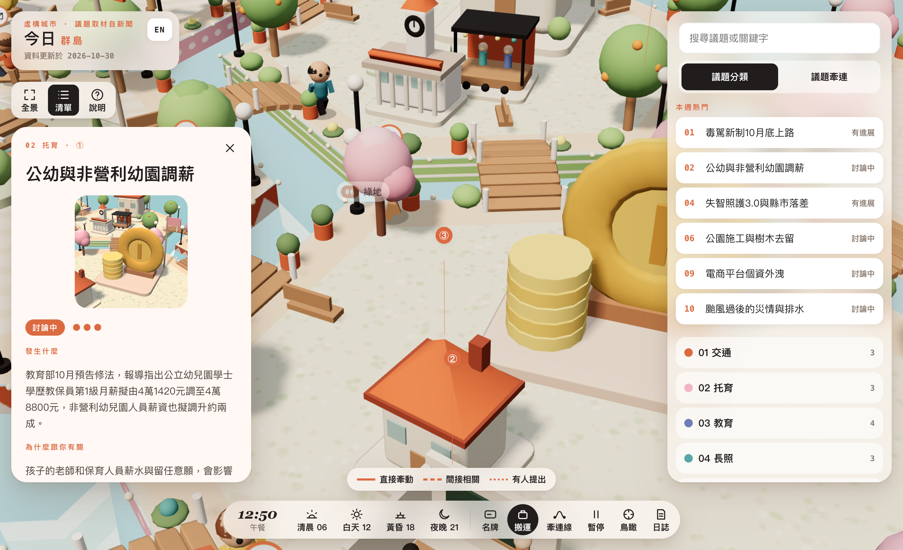
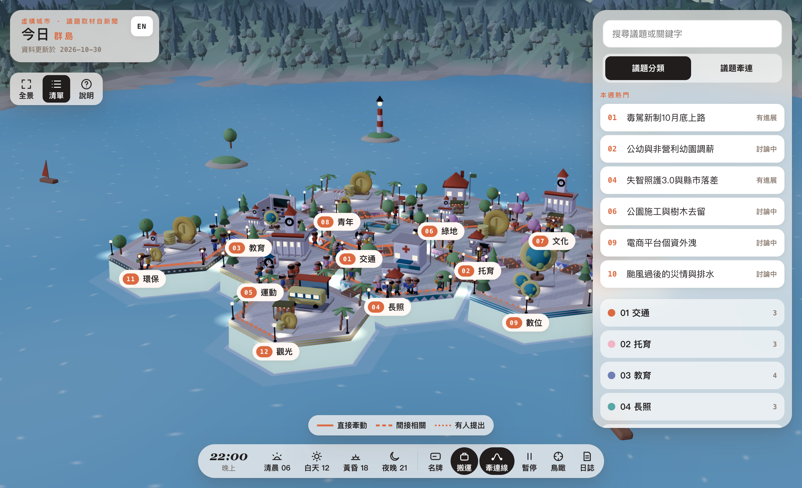

# 遊戲介紹

「今日群島」把城市此刻在討論的事，做成一座可以逛的微縮城市。這座城市是虛構的，議題取材自近期台灣的真實新聞。它不替任何人說話，只把一件事的來龍去脈和各方看法並排擺出來，附上新聞來源，讓你自己判斷。

## 島：議題分類

城市由 12 座六角形小島拼成，每座島是一類議題：

01 交通、02 托育、03 教育、04 長照、05 運動、06 綠地、07 文化、08 青年、09 數位、10 安全、11 環保、12 觀光。

每座島有自己的配色，島緣有一圈彩色圖案帶，種的樹也不一樣，有針葉樹、櫻花、果樹、棕櫚、柳樹。相鄰的島之間有木造小拱橋相連。

## 建物：一則議題

島上的每棟小建物是一則議題，每座島 3 到 8 則。建物會挑跟議題最貼近的樣子，例如大眾運輸的議題是候車亭，補助、價格的議題是一疊硬幣，數位、AI 的議題是地球儀。

建物共有 15 種：小屋、市政廳、攤位、教室、診所、公車站、單車架、球場、農田、河道、舞台、書、硬幣、時鐘、地球儀。

島上最大的那棟，是這座島目前最熱的議題。點開任何一則議題，卡片會依序告訴你：

- **狀態**：剛冒出來、討論中、有進展或已定案。
- **熱度**：一到三個圓點。
- **發生什麼**：一兩句話。
- **為什麼跟你有關**：這件事怎麼碰到一般人的日常。
- **各方怎麼看**：兩到三種立場並列。只寫角色，例如家長團體、業者、市府，不寫人名。
- **取材來源**：媒體名稱、日期和新聞連結。

## 旗子：本週熱門

熱度 3 的議題（全城最多 6 則），建物旁會插一支島色的小旗子，晚上旗頂會亮。右側清單最上方的「本週熱門」，會列出全城熱度 3 的議題。

## 小人與牽連線：議題之間的牽動

議題不會各自發生。城市裡有 9 條「牽連線」，每條連接兩類議題，例如：

- 長照與交通：高齡者怎麼出門。
- 托育與長照：上有老下有小。
- 安全與青年：詐騙盯上年輕人。

每條牽連線上有 5 到 8 個小人來回走，整座城市共 57 人。小人是大頭的 Q 版造型，身上的配件看得出角色：

- 公務員穿背心、掛識別證
- 研究員穿白袍
- 長者拄拐杖
- 學童戴黃帽
- 家長推嬰兒車
- 通勤族騎腳踏車
- 農夫戴斗笠
- 工人戴安全帽
- 旅客拖行李箱

線的樣式代表牽連的程度：

- **實線**：直接牽動。
- **虛線**：間接相關。
- **點線**：有人提出兩者有關。

## 一天的時段

城市從早上 10 點開始，時間自己往前走，每秒是 10 分鐘，2 分 24 秒走完一天。天空、陽光、水色都會跟著變化。入夜後窗戶亮起，路燈下出現光池，島緣串燈也會點亮。

一天分成 7 個時段：深夜、清晨、上學通勤、午餐、放學、黃昏、晚上。每個時段有幾類建物會亮起黃色，代表這個時間它正在派上用場。例如上學通勤時，公車站、單車架和教室會亮。

## 城市日誌

打開日誌，會看到小人到站、交接、出發的即時紀錄，像一份城市的工作日記。也可以只看某一條牽連線。

## 資料多久更新一次

議題會定期依新聞更新。品牌卡上的「資料更新於」，是最近一次更新的日期。更新方式見[更新守則](update-guide.md)。
